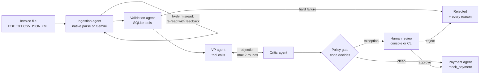

# Acme Invoice Agents

**A multi-agent accounts-payable system for the [Galatiq invoice case](https://github.com/galatiq-ai/galatiq-case-invoices).** It reads invoices in any of the supplied formats, validates them against a SQLite inventory, reasons through VP approval with a critic agent, and pays clean invoices through the mock payment API. Every exception reaches a person with the exact reason already written.

| | Result |
|---|---|
| The 20 supplied invoices | **5 paid, 2 duplicates blocked, 9 rejected, 4 held for a person**, and every scenario in the brief's table gets the expected outcome and reason |
| Scored evaluation (20 supplied + 15 added invoices) | **35/35 outcomes, 47/47 expected findings, 139/139 extracted fields**, both offline and live with Gemini ([live report](reports/eval-gemini.md), [offline report](reports/eval-offline.md)) |
| Live cost and speed | 89 model calls, about 65k tokens for all 35 invoices; about 8 s per invoice |
| Tests | 94 tests (plus 520 randomized safety cases), all offline, run in CI with lint, the evaluation and a Docker build |
| Dependencies | Python standard library, plus PyMuPDF for PDFs. No agent framework or LLM SDK to install |

---

## Contents

1. [Quick start](#1-quick-start)
2. [Five-minute walkthrough for reviewers](#2-five-minute-walkthrough-for-reviewers)
3. [Using Gemini](#3-using-gemini-optional)
4. [How it works](#4-how-it-works)
5. [What every invoice is checked for](#5-what-every-invoice-is-checked-for)
6. [Results on the supplied invoices](#6-results-on-the-supplied-invoices)
7. [Brief requirements checklist](#7-brief-requirements-checklist)
8. [Testing and evaluation](#8-testing-and-evaluation)
9. [Command reference](#9-command-reference)
10. [Business impact](#10-business-impact)
11. [Design decisions, scope and limits](#11-design-decisions-scope-and-limits)
12. [Project layout](#12-project-layout)
13. [Troubleshooting](#13-troubleshooting)

---

## 1. Quick start

You need **Python 3.11 or newer**. No API key is needed: offline mode runs the full workflow with rules-based stand-ins for the models.

**Step 1. Get the code and create a virtual environment**

```bash
git clone https://github.com/maahipatel05/acme-invoice-agents
cd acme-invoice-agents
python3 -m venv .venv
source .venv/bin/activate          # Windows: .venv\Scripts\activate
```

**Step 2. Install the one dependency (PyMuPDF, for reading PDFs)**

```bash
pip install -r requirements.txt
```

**Step 3. Run the brief's exact command**

```bash
python main.py --invoice_path=data/invoices/invoice1.txt
```

The supplied invoices are numbered from 1001, so `invoice1.txt` runs `invoice_1001.txt` (the CLI says so). You get one JSON log line per agent step on stderr, the brief's `mock_payment` output, and the full result as JSON on stdout:

```text
{"ms": 2, "agent": "ingestion", "action": "parsed", "summary": "Deterministic TXT layout parser (offline)"}
{"ms": 3, "agent": "validation", "action": "checked", "summary": "All checks passed"}
{"ms": 4, "agent": "approval", "action": "vp_decision", "summary": "Rules stand-in (offline): approve. All validation and policy checks passed"}
{"ms": 4, "agent": "approval", "action": "critic", "summary": "Rules stand-in (offline): decision matches the deterministic floor"}
{"ms": 5, "agent": "policy", "action": "gate", "summary": "Deterministic minimum approve; agents advised approve; final approve"}
Paid USD 5,000.00 to Widgets Inc.
{"ms": 6, "agent": "payment", "action": "mock_payment", "summary": "Paid USD 5,000.00 to Widgets Inc. (MOCK-fe23c630b0544df1)"}
```

**Step 4. Process all 20 supplied invoices**

```bash
python main.py --batch data/invoices --quiet
```

```text
file                       status                  amount  findings
invoice_1001.txt           paid              USD 5,000.00  -
invoice_1002.txt           rejected         USD 15,000.00  OVER_APPROVAL_LIMIT, STOCK_EXCEEDED
invoice_1003.txt           rejected        USD 100,000.00  OVER_APPROVAL_LIMIT, PAYMENT_PRESSURE, RELATIVE_DUE_DATE, UNKNOWN_VENDOR, ZERO_STOCK_ITEM
invoice_1004.json          paid              USD 1,890.00  -
invoice_1004_revised.json  duplicate         USD 5,940.00  DUPLICATE_PAID
...
2 duplicate, 5 paid, 4 pending_review, 9 rejected  (20 files, mode offline)
```

**Step 5. Open the review console**

```bash
python main.py --serve
```

Then open **http://127.0.0.1:8080**.

The SQLite database is created and seeded automatically at `.runtime/acme.db` (the brief's `inventory` table of item and stock, plus a catalog price, a vendor master, the workflow runs and the payment ledger). Add `--db path/to/other.db` to any command for a fresh workspace.

**Shortcuts:** `make install`, `make test`, `make eval`, `make batch`, `make serve`. With Docker: `make docker` builds the image (the tests run during the build) and serves the console on port 8080.

---

## 2. Five-minute walkthrough for reviewers

Start the console on a fresh workspace so the walkthrough is repeatable:

```bash
python main.py --serve --db .runtime/walkthrough.db
```

Open http://127.0.0.1:8080, then upload these files from `data/invoices/` (you can select several at once). Each one appears in the queue, and its agent steps show up live as they run.

| Upload | What you will see |
|---|---|
| `invoice_1001.txt` | Paid. The agent trail shows parsing, validation, the VP decision, the critic, the policy gate and the mock payment |
| `invoice_1004.json`, then `invoice_1004_revised.json` | The first is paid. The revision is blocked as a **duplicate**: the same vendor and invoice number cannot be paid twice |
| `invoice_1003.txt` | Rejected, with five findings: FakeItem has zero stock, due date "yesterday", unknown vendor, "URGENT ... wire transfer" pressure, $100,000 over the limit |
| `invoice_1009.json` | Rejected, with every problem listed at once: missing vendor, missing due date, negative quantity, negative total, subtotal mismatch |
| `invoice_1010.txt` | Held: a rush-order line is billed 20% over catalog. Enter a reviewer name and rationale, then **Approve and pay**. The decision, reviewer and payment are added to the trail |
| `invoice_1012.pdf` | Held: OCR damage (`3,500.O0`) and the vendor says it was "formerly FastShip Ltd." |
| `invoice_1014.xml` | Held: the invoice is in EUR. A person can approve it knowingly |

Then try uploading `invoice_1001.txt` again: you get the original result back, and no second payment is made. The queue filters (All, Needs review, Paid, Blocked) and the metrics at the top (straight-through rate, average time, value kept from payment) update as you go.

The same review works from the command line:

```bash
python main.py --queue                                   # invoices awaiting review, with run IDs
python main.py --review RUN_ID --decision approve --reviewer "Dana Ortiz, VP Finance" --reason "Rush premium agreed on PO 4471"
python main.py --ledger                                  # simulated payments
```

---

## 3. Using Gemini 

The agents run on Google Gemini when you pass `--mode gemini`. 

**Step 1.** Get a free API key from [Google AI Studio](https://aistudio.google.com/apikey).

**Step 2.** Create a `.env` file in the project root (it is gitignored and never committed):

```bash
echo "GEMINI_API_KEY=your-key-here" > .env
```

Optional settings for the same file:

| Variable | Default | Meaning |
|---|---|---|
| `GEMINI_API_KEY` | none | Required for Gemini mode |
| `GEMINI_MODEL` | `gemini-3.5-flash-lite` | Has the most generous free-tier rate limit of the models tested. Run `python main.py --list-models` to see what your key can use |
| `GEMINI_TIMEOUT_SECONDS` | `90` | Per-request timeout (1-180) |

Shell environment variables take precedence over `.env`.

**Step 3.** Add `--mode gemini` to any command:

```bash
python main.py --mode gemini --invoice_path data/invoices/invoice_1012.pdf
python main.py --mode gemini --batch data/invoices
python main.py --mode gemini --serve
python evals/run.py --mode gemini          # full scored evaluation, about 5 minutes
```

A live run shows the agents at work. This is an excerpt from `invoice_1012.pdf`:

```text
{"ms": 13483, "agent": "ingestion", "action": "extracted", "summary": "Gemini read the PDF document"}
{"ms": 13490, "agent": "ingestion", "action": "cross_check", "summary": "Every extracted number is printed in the source; deterministic parser agrees"}
{"ms": 13494, "agent": "validation", "action": "checked", "summary": "0 blocking, 3 needing review -> minimum outcome review"}
{"ms": 20162, "agent": "approval", "action": "tool:check_vendor", "summary": "check_vendor(QuickShip Distributers)"}
{"ms": 20164, "agent": "approval", "action": "tool:check_vendor", "summary": "check_vendor(FastShip Ltd.)"}
{"ms": 20167, "agent": "approval", "action": "tool:lookup_item", "summary": "lookup_item(Widget A)"}
{"ms": 20173, "agent": "approval", "action": "tool:payment_history", "summary": "payment_history(INV 1012, QuickShip Distributers)"}
{"ms": 27322, "agent": "approval", "action": "vp_decision", "summary": "VP agent: review. The invoice has multiple hold findings regarding vendor renaming (from FastShip Ltd.) and OCR extraction uncertainties..."}
{"ms": 29330, "agent": "approval", "action": "critic", "summary": "Critic agrees: The VP agent made the correct call by routing the invoice for human review..."}
```

If the model or network fails, the invoice stops with status `error` and **no payment is ever made**. Short rate-limit pauses (up to 60 s) are waited out automatically. A failed run can be released and resubmitted with `python main.py --recover RUN_ID` or the button in the console.

---

## 4. How it works



| Agent | What the model does (Gemini mode) | What code guarantees (always) |
|---|---|---|
| **Ingestion** | Reads TXT and PDF into a structured schema. When validation finds something a misread could cause (a total that does not add up, a missing field), it re-reads the document with those findings as feedback, up to twice | JSON, XML and CSV are parsed natively, with no model needed. Ambiguous sources (repeated headers, duplicate keys) are rejected before any model sees them. Every number the model reports must actually be printed in the document. The model's reading is compared with a deterministic parser |
| **Validation** | none | Arithmetic, stock, catalog prices, vendor master, duplicates, split billing and fraud signals ([full list](#5-what-every-invoice-is-checked-for)) |
| **Approval: VP + critic** | The VP agent decides which read-only tools to call (`check_vendor`, `lookup_item`, `payment_history`, `approval_policy`), usually in one parallel turn, then submits a structured decision. An independent critic reviews it; if the critic objects, the VP revises in the same conversation, at most twice | If VP and critic still disagree, a person decides. Invoices with a hard failure skip this step: no agent can override them |
| **Policy gate** | none | Code has the last word. Any blocking finding means reject, any hold means a person, and only a clean invoice is paid. A model can make the outcome more cautious, never less, and it cannot reject a rule-clean invoice on its own (that goes to a person) |
| **Payment** | none | Rechecks stock, ledger and vendor at commit time, then records the payment and calls the brief's `mock_payment(vendor, amount)` in one SQLite transaction |

In offline mode each model step is replaced by a rules stand-in, and the agent trail says which one ran. Every step is saved to SQLite as it happens: the console shows progress live, pending reviews survive restarts, and a crash leaves an inspectable record.

---

## 5. What every invoice is checked for

Every check produces a coded finding with a plain-English message. Validation does not stop at the first problem.

| Severity | Effect | Findings |
|---|---|---|
| **block** | Rejected. No agent or reviewer can override it | `MISSING_VENDOR`, `MISSING_INVOICE_NUMBER`, `MISSING_DUE_DATE`, `INVALID_DUE_DATE`, `RELATIVE_DUE_DATE` ("yesterday"), `NO_LINE_ITEMS`, `INVALID_LINE`, `INVALID_QUANTITY` (zero, negative, fractional), `INVALID_AMOUNT`, `MISSING_AMOUNT`, `LINE_AMOUNT_MISMATCH`, `SUBTOTAL_MISMATCH`, `TOTAL_MISMATCH` (lines + tax + shipping must equal the total), `UNKNOWN_ITEM`, `ZERO_STOCK_ITEM`, `STOCK_EXCEEDED` (summed across repeated lines), `DUPLICATE_PAID` (same vendor and invoice number already paid, in any format or revision), `UNREADABLE_DOCUMENT` |
| **hold** | Needs a person, who can approve or reject | `OVER_APPROVAL_LIMIT` (over $10,000), `PRICE_VARIANCE` (more than 10% over catalog), `UNKNOWN_VENDOR`, `VENDOR_LOOKALIKE` ("Widgets lnc.", Greek-letter homoglyphs), `VENDOR_RENAMED` ("formerly ..."), `NON_USD_CURRENCY`, `INVALID_CURRENCY`, `SPLIT_INVOICE` (several invoices from one vendor in 30 days that together cross $10,000), `DUPLICATE_PENDING`, `PAYMENT_PRESSURE` ("urgent", "wire transfer", "change of bank details"), `PROMPT_INJECTION`, `EXTRACTION_UNCERTAINTY` (for example OCR damage), `EXTRACTION_UNGROUNDED` (a model value not printed in the document), `EXTRACTION_DISAGREEMENT`, `MODEL_CONCERN`, `CRITIC_DISAGREEMENT` |
| **info** | Recorded, no effect | `CURRENCY_ASSUMED_USD`: no currency code is printed, so the invoice is treated as USD, Acme's settlement currency, and the run says so |

Money is stored as integer cents and parsed strictly (`1,2.00` and `$1$0.00` are rejected, never reinterpreted). Product names match regardless of case, spacing and punctuation (`Widget A` = `WidgetA`), but unknown products are never fuzzy-matched to known ones.

---

## 6. Results on the supplied invoices

All 20 files are processed in filename order against one shared ledger, so revisions and cross-format duplicates are exercised:

| Invoice | Outcome | Why |
|---|---|---|
| 1001, 1004, 1006, 1011 (PDF), 1015 | **Paid** | All checks pass |
| 1004 revised, 1011 (TXT) | **Duplicate** | Same vendor and invoice number already paid: a revision, and a TXT copy of the paid PDF |
| 1002, 1005 | **Rejected** | GadgetX quantity exceeds stock (20 and 8 requested, 5 in stock) |
| 1003 | **Rejected** | FakeItem has zero stock; due "yesterday"; unknown vendor; "URGENT ... wire transfer"; $100,000 |
| 1007, 1013 (JSON and PDF) | **Rejected** | Stated total does not equal lines + tax ($110 under and $50 over); stock also exceeded |
| 1008, 1016 | **Rejected** | Unknown items: SuperGizmo, MegaSprocket, WidgetC |
| 1009 | **Rejected** | Missing vendor and due date, negative quantity, negative total, subtotal mismatch |
| 1010 | **Held** | Rush-order WidgetA billed at $300 vs $250 catalog (+20%) |
| 1012 (TXT and PDF) | **Held** | OCR damage (`3,500.O0`); vendor says it was "formerly FastShip Ltd."; the second copy is also flagged as a pending duplicate |
| 1014 | **Held** | Invoice is in EUR |

Fifteen extra scenarios in `data/scenarios/` test what the supplied set does not: a natural-language email invoice, a lookalike vendor ("Widgets lnc."), a Greek-letter homoglyph vendor, a bank-change request, overbilling, prompt injection, a disguised credit note, fractional quantities, an over-limit invoice and clean copies in every format.

---

## 7. Brief requirements checklist

| Requirement in the brief | How it is met | Where |
|---|---|---|
| Multi-agent system, working prototype | Ingestion, validation, VP, critic and payment agents with an orchestrator, a CLI and a web console | `acme/agents.py`, `acme/workflow.py` |
| Ingestion from PDFs and text: vendor, amount, items with quantities, due date | Native parsers for JSON, XML and CSV; layout parser and Gemini extraction for TXT and PDF; PyMuPDF for PDF text | `acme/ingestion.py`, `acme/layouts.py` |
| Handle typos, missing data and fraudulent entries | Every defect becomes a coded finding; OCR damage is flagged; fraud signals include zero-stock items, relative due dates, pressure language, lookalike and renamed vendors, prompt injection and split billing | `acme/domain.py`, `acme/tools.py` |
| Validate against a SQLite inventory; flag stock mismatches and unknown items | The brief's seed (WidgetA 15, WidgetB 10, GadgetX 5, FakeItem 0), extended with catalog prices and a vendor master; stock is summed across repeated lines | `acme/store.py`, `acme/tools.py` |
| Flag invalid data such as negative quantities | `INVALID_QUANTITY`, `INVALID_AMOUNT` and the arithmetic findings | `acme/domain.py` |
| VP approval with rules, extra scrutiny over $10K | Invoices over $10,000 always need a person; a code-enforced policy gate | `acme/agents.py` |
| Reflection or critique loop | An independent critic reviews the VP's decision and can send it back for revision (bounded at two rounds) | `ApprovalAgents` in `acme/agents.py` |
| If approved, call the mock payment; if rejected, log the reasoning | `mock_payment(vendor, amount)` as given, inside an atomic ledger transaction; rejections are logged with every reason | `acme/store.py`, `acme/workflow.py` |
| LLM integration (Grok, or another model without a key) | Gemini through its REST API, with structured output and function calling | `acme/gemini.py` |
| Orchestration (framework or custom) | Custom orchestrator with persisted steps and bounded loops | `acme/workflow.py` |
| Function calling, structured outputs, self-correction | Multi-turn tool loop with parallel calls; JSON-schema outputs; extraction re-reads with validation feedback | `acme/gemini.py`, `acme/agents.py` |
| No internet for external APIs; simulate locally | Offline mode runs everything with no network; inventory, vendors and banking are local | `--mode offline` (default) |
| Python, local, no cloud deployment | Python 3.11+, SQLite, loopback-only web server | |
| `python main.py --invoice_path=data/invoices/invoice1.txt` | Works as written; outputs structured logs and the result | `main.py` |
| Evaluation: functionality, code quality, agentic sophistication, shipping mindset, presentation, above and beyond, UI/UX | Scored evaluation, 94 tests, CI, review console, business framing below, 15 added scenarios | `evals/`, `tests/`, `acme/static/` |

---

## 8. Testing and evaluation

```bash
python -m unittest discover -b -s tests      # 94 tests, about 5 seconds, no key or network
python evals/run.py                          # scored evaluation, offline, about a second
python evals/run.py --mode gemini            # the same evaluation with live Gemini agents
```

- **Corpus tests:** all 20 supplied invoices run end to end against values transcribed by hand from the documents (invoice number, vendor, due date, total and every line), plus the brief's scenario table. A check also confirms the supplied files are unmodified.
- **Randomized safety tests:** 520 generated broken invoices (bad totals, odd quantities, unknown items, lookalike vendors, duplicates) check invariants rather than hand-picked answers: money moves only when every rule holds, nothing is paid twice, and stock is never altered.
- **Agent tests:** a scripted model drives the real workflow: tool calls, critic objection and revision, extraction self-correction, invented numbers, a model trying to approve a held invoice, provider failures and recovery, and stock changing while agents reason.
- **Gemini contract tests:** retries, rate limits, key secrecy and the function-calling protocol (call IDs, thought signatures, parallel calls), all without network access.
- **HTTP tests:** go through the real request handler: CSRF and Host checks, background processing, review and recovery.

The evaluation writes `reports/eval-offline.md` or `reports/eval-gemini.md`, with outcome accuracy, finding recall, extraction field accuracy, and time and token cost per invoice. CI (`.github/workflows/verify.yml`) runs lint, the tests, the evaluation, the brief's command and a Docker build on every push.

---

## 9. Command reference

| Command | What it does |
|---|---|
| `python main.py --invoice_path FILE` | Process one invoice: logs on stderr, JSON result on stdout |
| `python main.py --batch DIR` | Process every invoice in a folder and print a summary table (`--quiet` hides step logs) |
| `python main.py --serve [--port 8080]` | Start the review console (loopback only) |
| `python main.py --queue` | List invoices awaiting review, with run IDs and reasons |
| `python main.py --review RUN_ID --decision approve\|reject --reviewer NAME --reason TEXT` | Decide an invoice awaiting review |
| `python main.py --ledger` | List simulated payments |
| `python main.py --recover RUN_ID` | Release a failed or interrupted run so the file can be resubmitted |
| `python main.py --list-models` | List the Gemini models your key can use |
| `--mode gemini` | Use the Gemini agents (any processing command) |
| `--db PATH` | Use a different SQLite workspace (default `.runtime/acme.db`) |

---

## 10. Business impact

Acme loses about **$2M a year** to manual invoice handling: a **30% error rate**, **five-day delays** and VP approvals buried in email. The costly failures are paying the wrong amount, paying twice, paying a fake vendor, and clean invoices waiting behind messy ones. Each one has a direct control here:

| Pain today | What the system does |
|---|---|
| Keying errors and wrong amounts | Extraction is checked against arithmetic, catalog prices and the source document itself. A total that does not add up is rejected, with the exact difference stated |
| Duplicate and revised invoices paid twice | The ledger identity (vendor + invoice number) blocks a second payment, whatever the file format or revision |
| Fraud: fake vendors, pressure tactics, split billing | Vendor master with lookalike and rename detection, pressure-language and prompt-injection flags, and a 30-day split-billing check |
| Five-day delays and approvals in email | Clean invoices are paid in seconds with no human touch. People see only exceptions, with the reason already written and one click to decide |
| No visibility | Every decision has a full agent trail; the console tracks straight-through rate, processing time and value kept from payment |

On the supplied set, 5 of 20 invoices need no human touch, and the other 15 arrive with every reason attached. In a pilot, track the straight-through rate, false approvals, false holds, extraction field accuracy, review age and cost per invoice. These are the measurements to prove ROI; this prototype does not claim savings it has not measured.

---

## 11. Design decisions, scope and limits

**Design decisions**

- **Models read and reason; code owns money.** Arithmetic, stock, policy and payment are deterministic and tested. A model can make an outcome more cautious, never less.
- **Report every finding.** An operator fixes everything in one pass, instead of resubmitting once per error.
- **Record assumptions instead of hiding them.** A `$` with no currency code is treated as USD, and the run says so. An explicit EUR invoice is held for a person.
- **Guarded self-correction.** The extraction agent re-reads the document when validation suggests a misread, but a model value that is not printed in the document always holds the invoice. The model cannot "fix" an invoice by inventing numbers.
- **Custom orchestration instead of LangGraph.** The workflow is four stages with two bounded loops. A plain Python orchestrator keeps it readable in one file, testable with a scripted model and dependency-free, and SQLite already persists every step. For long-running human waits across services in production, LangGraph's checkpointing would be worth adopting.
- **Gemini instead of Grok.** No xAI key was available, which the brief allows, and Galatiq confirmed any model is acceptable. The adapter is one module, so switching providers is a contained change.

**Scope and limits**

No real email intake, bank API, login or cloud deployment, as the brief allows. Reviewer names are typed, not authenticated. Stock is checked per invoice and not reserved across invoices: paying a supplier does not consume warehouse stock. Gemini reads scanned PDFs, but only the supplied text PDFs have been tested.

**Before production:** a real bank API cannot share a database transaction, so payments need an outbox, the provider's idempotency key and daily reconciliation. Reviewers need SSO and per-person approval limits. Source documents should be stored, not just hashed. A three-way match against purchase orders and goods receipts is the real inventory control.

---

## 12. Project layout

```
main.py                 CLI: single invoice, batch, console, queue, ledger, review, recover
acme/
  agents.py             ingestion and approval (VP + critic) agents, and the policy gate
  workflow.py           orchestrator, payment and human review
  tools.py              read-only SQLite tools shared by validation and the agents
  domain.py             money parsing, normalization and coded findings
  ingestion.py          file reading and PDF text (PyMuPDF)
  layouts.py            deterministic TXT and CSV layout parsers
  gemini.py             Gemini REST: retries, structured output, function-calling loop
  store.py              SQLite schema, seed data and mock_payment
  server.py             loopback-only HTTP server for the console
  static/               review console (HTML, CSS, JS; no external assets)
data/
  invoices/             the 20 supplied invoices, unmodified
  scenarios/            15 added test scenarios
  generate_pdfs.py      the case's optional PDF generator
evals/                  golden expectations and the evaluation runner
reports/                latest evaluation reports
tests/                  domain, parser, workflow, tool, property, corpus, HTTP and Gemini tests
tools/                  demo PDF generator and a macOS PDF text fallback
Makefile, Dockerfile    one-command install, test, evaluation, console and container
```

---

## 13. Troubleshooting

| Problem | Fix |
|---|---|
| `PDF support needs: pip install -r requirements.txt` | Install PyMuPDF with `pip install -r requirements.txt` (on macOS, a built-in fallback is used if it is missing) |
| `python: command not found` | Use `python3`, or activate the virtual environment from step 1 |
| `Set GEMINI_API_KEY for Gemini mode` | Create `.env` as in [section 3](#3-using-gemini-optional), or leave out `--mode gemini` to run offline |
| `Gemini HTTP 429 ... retry after 58s` | Free-tier rate limit. Pauses up to 60 s are waited out automatically; if it persists, wait a minute, then run `--recover RUN_ID` and resubmit. No payment is made on errors |
| `Gemini HTTP 404` | The model is not available to your key. Run `python main.py --list-models` and set `GEMINI_MODEL` |
| Port 8080 already in use | `python main.py --serve --port 8090` |
| Want a clean slate | Delete `.runtime/`, or pass `--db` with a new file name |
